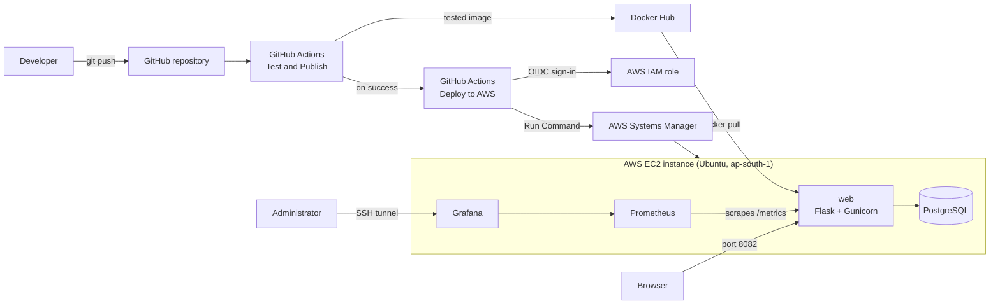

## Task Tracker: Complete DevOps Project

A responsive task management application built with Flask and PostgreSQL,
taken through the full DevOps lifecycle: containerization, automated testing,
image publishing, cloud deployment on AWS, automated releases, and monitoring.

Users can create, complete, reopen, and delete tasks. PostgreSQL stores tasks in a persistent Docker volume.

### Project Overview

| Stage | What it covers | Where |
|---|---|---|
| Source control | Git history and GitHub repository | This repository |
| Containerization | Application image running as a non-root user | `Dockerfile` |
| Multi-container application | Flask and PostgreSQL with health checks and a persistent volume | `compose.yaml` |
| Continuous integration | Build, automated tests, and image publishing to Docker Hub | `.github/workflows/ci.yml`, `tests/` |
| Cloud deployment | Ubuntu EC2 instance in AWS Mumbai (`ap-south-1`) | `compose.aws.yaml` |
| Automated deployment | Every successful push to `main` is released to EC2 | `.github/workflows/deploy.yml` |
| Monitoring | Prometheus metrics and a Grafana dashboard | `compose.monitoring.yaml`, `compose.grafana.yaml`, `monitoring/` |

### System Architecture



1. A push to `main` starts the **Test and Publish** workflow, which builds
   the image, runs the tests, and publishes the image to Docker Hub.
2. When the tests pass, the **Deploy to AWS** workflow signs in to AWS with
   OIDC and uses Systems Manager to deploy that exact image to EC2.
3. On EC2, Docker Compose runs the application, PostgreSQL, Prometheus,
   and Grafana. Only SSH and the application port are reachable from
   outside, and only from an allowed IP address.

### Features

- Add tasks with titles up to 200 characters.
- Mark tasks as complete or reopen them.
- Delete tasks.
- Responsive interface for desktop and mobile screens.
- Persistent database storage.
- CSRF protection for forms.
- Health checks for the application and database.
- Application container runs as a non-root user.

### Technologies

| Technology | Purpose |
|---|---|
| Python and Flask | Application backend |
| HTML, CSS, and Jinja | Responsive user interface |
| Flask-SQLAlchemy | Database models and queries |
| PostgreSQL | Task storage |
| Flask-WTF | CSRF protection |
| Gunicorn | Application server |
| Docker Compose | Service configuration and management |
| GitHub Actions | Continuous integration and automated deployment |
| Docker Hub | Container image registry |
| AWS EC2 | Cloud server hosting the application |
| AWS IAM (OIDC) and Systems Manager | Keyless deployment access and remote commands |
| Prometheus and Grafana | Metrics collection and dashboards |

### Local Architecture

The browser accesses the Flask application on localhost port 8082.
The application connects to PostgreSQL using the Compose service name `db`.

| Service | Description | Ports |
|---|---|---|
| `web` | Flask application served by Gunicorn | Laptop `8082` → container `8000` |
| `db` | PostgreSQL 17 database | Container `5432`; not published to the laptop |

Compose waits for the database health check to pass before starting the application. The application initializes its database tables before starting Gunicorn.

The webpage is bound to `127.0.0.1` for local access.

### Project Files

| File | Purpose |
|---|---|
| `app.py` | Application routes, database model, and health endpoint |
| `templates/index.html` | Webpage template and responsive styles |
| `requirements.txt` | Python dependencies |
| `Dockerfile` | Application image build instructions |
| `compose.yaml` | Application, database, health checks, and volume configuration |
| `.env.example` | Example environment configuration |
| `.gitignore` | Files excluded from Git |
| `.dockerignore` | Files excluded from the Docker build context |
| `README.md` | Setup and usage documentation |

### Prerequisites

- Git
- Docker Desktop with the engine running
- Docker Compose

Verify Compose is available:

```sh
docker compose version
```

Python and PostgreSQL do not need to be installed on the host because they run inside containers.

### Setup

Clone the repository:

```sh
git clone https://github.com/Pavithira-R/docker-compose-task-tracker.git
cd docker-compose-task-tracker
```

Create your local environment file.

On Windows PowerShell:

```powershell
Copy-Item .env.example .env
notepad .env
```

On macOS or Linux:

```sh
cp .env.example .env
```

Edit `.env` and replace both placeholders:

```dotenv
POSTGRES_USER=taskuser
POSTGRES_DB=tasktracker
POSTGRES_PASSWORD=replace_with_your_own_random_password
SECRET_KEY=replace_with_your_own_random_secret
```

Use a new random password for this project's database and a different random value for the Flask secret key.

Keep `.env` private. Never commit it to Git.

### Build and Run

Validate the Compose configuration:

```sh
docker compose config --quiet
```

Build and start both services:

```sh
docker compose up -d --build
```

Check their status:

```sh
docker compose ps
```

Wait until both services show `healthy`, then open:

http://localhost:8082

### Using the Application

1. Enter a task and select **Add task**.
2. Select **Complete** to mark it as done.
3. Select **Undo** to reopen a completed task.
4. Select **Delete** to remove a task.

This learning application does not include user accounts. Anyone with access to the application can manage its tasks.

### Health Check

Open:

http://localhost:8082/health

When the application can connect to PostgreSQL, it returns HTTP 200:

```json
{"status": "healthy"}
```

If the database check fails, it returns HTTP 503.

### Verify Persistent Storage

1. Add a task in the application.
2. Remove the containers:

```sh
docker compose down
```

3. Recreate them:

```sh
docker compose up -d
```

4. Wait for the services to become healthy and refresh the webpage.

The task should still appear because PostgreSQL data is stored in the named volume `postgres_data`.

**Warning:** `docker compose down -v` deletes the database volume and its saved tasks.

### Useful Commands

View service status:

```sh
docker compose ps
```

View logs:

```sh
docker compose logs --tail=100
```

Follow application logs:

```sh
docker compose logs -f web
```

Press Ctrl+C to stop following logs; the containers keep running.

Stop services without removing containers:

```sh
docker compose stop
```

Start existing stopped containers:

```sh
docker compose start
```

Remove containers and the project network while keeping database data:

```sh
docker compose down
```

Rebuild after changing application code or dependencies:

```sh
docker compose up -d --build
```

### Troubleshooting

**Cannot connect to the Docker engine**

Open Docker Desktop and wait until its engine is running, then retry.

**Port 8082 is already in use**

Stop the application using that port or change the Compose port mapping to:

```yaml
ports:
  - "127.0.0.1:8084:8000"
```

Then run `docker compose up -d` and open http://localhost:8084.

**Application does not become healthy**

Check the service status and logs:

```sh
docker compose ps
docker compose logs --tail=100 web db
```

Do not publish logs containing credentials.

**Database password changed after the first run**

PostgreSQL initialization settings apply when its data directory is first created. Editing `.env` alone does not change the password of an existing database user.

Restore the original configuration or update the database user's password deliberately. Do not delete the volume unless you intend to erase its data.

### Verification Completed

- Built the application image successfully.
- Started the application and database with Docker Compose.
- Confirmed both services reported healthy.
- Tested task creation, completion, reopening, and deletion.
- Confirmed tasks remained saved after containers were recreated.

  ### CI/CD Pipeline

GitHub Actions builds the application and starts PostgreSQL in an isolated test environment.
The pipeline runs four automated tests covering database health, task creation/completion/reopening/deletion, empty input validation, and CSRF protection.
Pull requests run the build and tests. Successful pushes to main also publish the tested image to Docker Hub with latest and commit-specific tags.
Docker Hub credentials are stored in GitHub Actions secrets. Temporary test containers and volumes are removed afterward.
After a successful push to main, the tested image is deployed to AWS
automatically. See [Deployment Automation](#deployment-automation).

### AWS Deployment

Deployed on an Ubuntu 24.04 LTS EC2 instance in Mumbai
(ap-south-1), using Docker Engine and Docker Compose.

The standalone `compose.aws.yaml` configuration pulls the
published application image from Docker Hub and runs it
alongside PostgreSQL.

#### Server Setup

Install Docker Engine and the Compose plugin, clone this
repository, and enter its directory.

Create a private `.env` file containing:

- POSTGRES_USER
- POSTGRES_DB
- POSTGRES_PASSWORD
- SECRET_KEY

Use separate random values for the database password and
Flask secret key. Restrict file permissions:

```sh
chmod 600 .env
```

Never commit `.env` or SSH private keys.

#### Start the Deployment

```sh
sudo docker compose -f compose.aws.yaml config --quiet
sudo docker compose -f compose.aws.yaml pull
sudo docker compose -f compose.aws.yaml up -d --wait --wait-timeout 180
```

#### Verify the Deployment

```sh
sudo docker compose -f compose.aws.yaml ps
curl -fsS http://localhost:8082/health
```

Both services should report healthy. The health endpoint
returns HTTP 200 with `{"status":"healthy"}`.

Visit `http://<EC2-public-IP>:8082` from an allowed connection.

#### Network Access

The EC2 security group allows:

| Port | Purpose | Source |
|---|---|---|
| 22 | SSH administration | My public IPv4 address /32 |
| 8082 | Application access | My public IPv4 address /32 |

PostgreSQL port 5432 is not published on the server.

This is an HTTP practice deployment with access restricted
to my IP. It does not yet include HTTPS or user accounts.
Reviewers require a separately authorized source IP to access it.

The public IP may change after stopping and starting EC2.

#### Data and Cost Management

PostgreSQL data is stored in a named Docker volume.

Stop the EC2 instance between practice sessions to reduce
compute usage. EBS storage continues to incur costs while
the instance is stopped.

Do not run `docker compose down -v` unless you intend to
delete the saved database.

Back up required data before terminating the instance and
deleting its storage.

### Cloud Recovery Verification

The application is hosted on AWS EC2 in Mumbai.

- Both services use the `unless-stopped` restart policy.
- PostgreSQL stores data in a persistent Docker volume.
- SSH and application access are restricted to my public IP.
- Environment credentials remain outside version control.

Verification:
1. Created a task named "AWS persistence test".
2. Rebooted the EC2 instance.
3. Confirmed the application recovered without manually starting containers.
4. Confirmed the saved task remained available.


### Application Monitoring

Prometheus collects Flask application metrics every 15 seconds.
Grafana displays them in the Task Tracker Monitoring dashboard.

#### Dashboard Panels

| Panel | Purpose |
|---|---|
| Application Reachable | Shows whether Prometheus can scrape the application |
| Requests per Second | Five-minute average HTTP request rate |
| Average Response Time | Average Flask request processing time |
| Server Errors per Second | Rate of HTTP 500–599 responses |

Request metrics include application health checks.
Successful metrics collection does not independently confirm
database health; use `/health` to check database connectivity.

#### Configuration Files

- `compose.monitoring.yaml`: Prometheus service and storage settings.
- `compose.grafana.yaml`: Grafana service and persistent storage.
- `monitoring/prometheus.yml`: Application scrape configuration.
- `monitoring/grafana/datasources/prometheus.yaml`: Grafana data source.
- `monitoring/task-tracker-dashboard.json`: Exported dashboard.

#### Start Application and Monitoring

On the configured AWS server, run:

```sh
sudo docker compose -f compose.aws.yaml -f compose.monitoring.yaml -f compose.grafana.yaml up -d
```

Prometheus retains metrics for up to one day, with a 256 MB
retention-size setting. Actual disk usage also includes
operational files and overhead.

#### Access Through SSH

Prometheus and Grafana bind only to the server's loopback interface.
No inbound AWS rules are opened for ports 9090 or 3000.

From your laptop, substitute your key path and EC2 public IP:

```sh
ssh -i "<path-to-key.pem>" -o ExitOnForwardFailure=yes -o ServerAliveInterval=30 -L 127.0.0.1:3000:127.0.0.1:3000 -L 127.0.0.1:9090:127.0.0.1:9090 ubuntu@<EC2-public-IP>
```

Keep the SSH connection open, then visit:

- Grafana: http://localhost:3000
- Prometheus: http://localhost:9090

For a fresh Grafana installation, sign in with the default
admin credentials and immediately choose a private password.
Import `monitoring/task-tracker-dashboard.json` into Grafana
and select the provisioned Prometheus data source if prompted.

#### Verification

- Confirmed the application exposes `/metrics`.
- Confirmed Prometheus reports `up{job="task-tracker"} = 1`.
- Verified all four dashboard panels display data.
- Stopped the web service and confirmed reachability changed to 0.
- Restored the service and confirmed reachability returned to 1.

The dashboard provides visibility; external alert notifications
have not been configured.

### Deployment Automation

Every successful push to `main` is deployed to the EC2 server
without manual steps.

#### Deployment Flow

1. A commit is pushed to `main`.
2. The **Test and Publish Task Tracker** workflow builds the image,
   runs the automated tests, and pushes the image to Docker Hub
   tagged `sha-<commit>`.
3. When that workflow succeeds, the **Deploy Task Tracker to AWS**
   workflow (`.github/workflows/deploy.yml`) starts.
4. GitHub Actions signs in to AWS using OpenID Connect (OIDC) and
   assumes a deployment role. No AWS access keys are stored in GitHub.
5. The workflow sends a command to the EC2 instance through
   AWS Systems Manager (SSM) Run Command. SSH is not used.
6. On the server, the command:
   - pulls the image for that exact commit,
   - records it in `compose.release.yaml`,
   - recreates only the `web` service and waits for it to become healthy,
   - checks `http://localhost:8082/health`.
7. The workflow fails if the health check fails or the command times out.

Only pushes to `main` from this repository are deployed. Pull requests
and failed test runs never reach the server. A lock file on the server
prevents two deployments from running at the same time.

#### AWS Configuration

| Resource | Configuration |
|---|---|
| IAM OIDC identity provider | `token.actions.githubusercontent.com` with audience `sts.amazonaws.com` |
| Deployment role | `GitHubTaskTrackerDeployRole`, trusted only for the `main` branch of this repository |
| Role permissions | `ssm:SendCommand` on this instance and the `AWS-RunShellScript` document; `ssm:GetCommandInvocation` to read the result |
| EC2 instance profile | `TaskTrackerEC2SSMRole` with the `AmazonSSMManagedInstanceCore` policy |

The server must already contain the cloned repository, the private
`.env` file, and the monitoring Compose files described above.

#### GitHub Configuration

Repository variables (Settings → Secrets and variables → Actions → Variables):

| Variable | Purpose |
|---|---|
| `AWS_ROLE_ARN` | ARN of the deployment role |
| `AWS_REGION` | `ap-south-1` |
| `EC2_INSTANCE_ID` | ID of the EC2 instance |

Enter values without leading or trailing spaces or tabs. A hidden tab
in a copied value makes AWS reject the request.

#### Verify a Deployment

- In GitHub, open **Actions → Deploy Task Tracker to AWS** and check that
  the latest run succeeded. The log of the
  **Deploy tested image and verify health** step ends with the deployed
  image tag and `Deployment and health verification succeeded.`
- In AWS, open **Systems Manager → Run Command → Command history** in the
  Mumbai region to see the command and its output.
- On the server, confirm the running image:

```sh
sudo docker inspect --format '{{.Config.Image}}' docker-compose-task-tracker-web-1
```

#### Roll Back

Every published image is tagged with its commit, so an earlier version
can be restored.

- **From GitHub:** open an earlier successful run of
  **Deploy Task Tracker to AWS** and select **Re-run all jobs**. The re-run
  deploys the image from that run's commit.
- **On the server:** set the image in `compose.release.yaml` to an earlier
  tag and recreate the web service:

```sh
cd ~/docker-compose-task-tracker
sudo docker compose -p docker-compose-task-tracker \
  -f compose.aws.yaml -f compose.monitoring.yaml \
  -f compose.grafana.yaml -f compose.release.yaml \
  up -d --no-deps --wait web
```

Include `compose.release.yaml` in manual Compose commands on the server
so the deployed image version is kept. The next push to `main` deploys
the newest commit again.

#### Verification

- Pushed a commit to `main` and confirmed both workflows ran automatically.
- Confirmed the deployment run reported the image tag of the pushed commit.
- Confirmed `/health` returned `{"status":"healthy"}` after the deployment.

### Project Scope

This project demonstrates a local Docker Compose application with database integration and persistent storage.

Cloud deployment, automated deployment, and monitoring dashboards are planned extensions.

### Author

Pavithira Rajkumar
